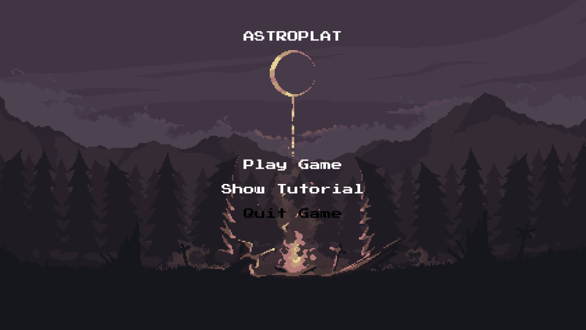
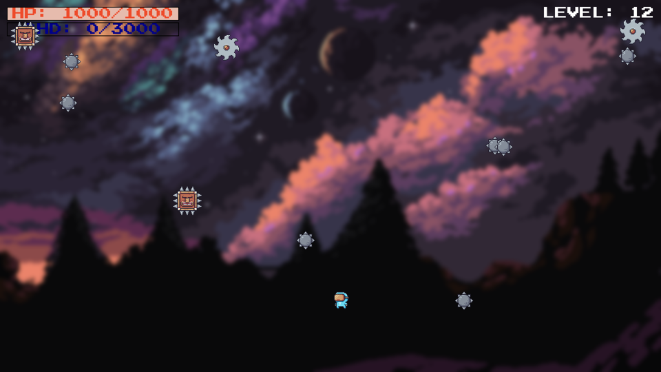

# AstroPlat

AstroPlat je 2D arkadna igra preživetja, ki sem jo napisal v Pythonu s knjižnico Pygame. Igralec vodi astronavta, ki se izmika pastem, te pa z vsako stopnjo težavnosti prihajajo hitreje in po zahtevnejših poteh.





## Kako se igra

Z desne strani zaslona letijo pasti: bodičaste krogle, žage in bodičaste glave. Vsaka ob trku odvzame del življenja. Sadje življenje obnovi, odvečno zdravljenje pa se pretvori v ščit, ki prestreže naslednje udarce. Na približno 13 sekund se težavnost dvigne in pojavijo se nove pasti. Igra se konča, ko igralcu zmanjka življenja, končni rezultat pa je dosežena stopnja.

| Tipka | Dejanje |
| --- | --- |
| A / D | premik levo / desno |
| SPACE | skok (tudi večkratni skok v zraku) |
| ESC | premor |
| SPACE (med premorom) | nadaljevanje |

V igri je skrito tudi presenečenje (easter egg).

## Kaj sem uporabil

- **Objektno programiranje:** razreda `Player` in `Obstacle` na osnovi `pygame.sprite.Sprite`
- **Animacije:** sličice likov se samodejno izrežejo iz sprite sheetov in obrnejo glede na smer gibanja
- **Natančni trki:** zaznavanje trkov na ravni pikslov z maskami (`pygame.mask`)
- **Gibanje pasti:** sinusne, kosinusne, diagonalne in osmičaste poti
- **Generator za ustvarjanje pasti:** verjetnost in vrsta pasti sta odvisni od trenutne stopnje
- **Sistem življenja in ščita:** z vrstico za prikaz in kratko neranljivostjo po zadetku
- **Zaslona:** meni z navodili ter zaslon za konec igre z možnostjo ponovnega igranja
- **Izvršljiva datoteka:** pripravljena za PyInstaller (funkcija `resource_path`)

## Zagon

Potrebuješ Python 3.10 ali novejši.

```
pip install -r requirements.txt
python astroplat.py
```

Igra je narejena za ločljivost 1920 × 1080.

### Izdelava .exe datoteke (Windows)

```
pip install pyinstaller
pyinstaller --onefile --windowed --name AstroPlat --add-data "assets;assets" astroplat.py
```

Že pripravljena `AstroPlat.exe` je na voljo pod **Releases**.

## Avtor in viri

- Avtor: Andraž Cerar
- Grafika likov, pasti in sadja: [Pixel Adventure](https://pixelfrog-assets.itch.io/pixel-adventure-1), avtor Pixel Frog
